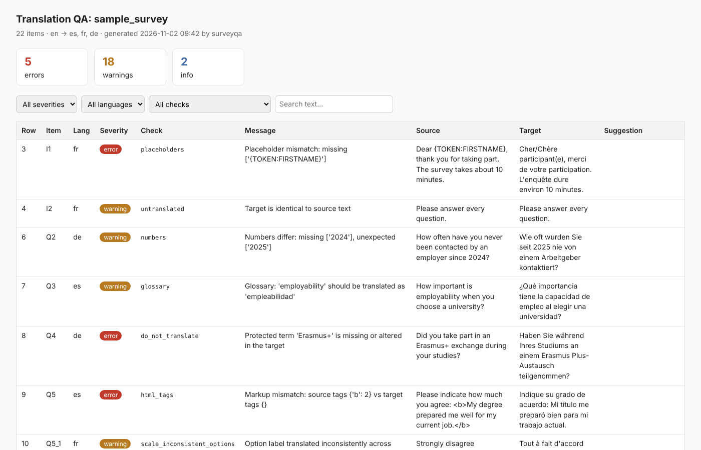

# surveyqa

**Quality assurance for multilingual survey translations.** Catch broken placeholders, answer-scale
errors, glossary violations and meaning drift *before* fieldwork, when fixing them is still cheap.

```
$ surveyqa check survey.csv --glossary glossary.csv -o report.html

surveyqa: survey  (24 items, en -> es, fr, de)
  9 errors, 14 warnings, 3 info

  [E] row    3  I1           fr    placeholders               Placeholder mismatch: missing ['{TOKEN:FIRSTNAME}']
  [E] row   10  Q5_5         es    scale_duplicate_labels     Scale 'AGREE_Q5': option 'Q5_5' has the same translation...
  [W] row    6  Q2           de    numbers                    Numbers differ: missing ['2024'], unexpected ['2025']
  ...
```



## Why

Translated questionnaires are usually reviewed in spreadsheets by one bilingual colleague. The
errors that hurt cross-country comparability (a reversed scale, a dropped negation, "never" turned
into "rarely", a missing piping variable) are often only noticed after the data is in.

surveyqa supports the **Review** and **Documentation** steps of the
[TRAPD](https://ccsg.isr.umich.edu/chapters/translation/overview/) model (Translation, Review,
Adjudication, Pretesting, Documentation) used by large cross-national surveys. It does not replace
human reviewers: it gives them a ranked list of things to look at, and leaves a written trail.

## What it checks

| Check | Category | What it catches |
|---|---|---|
| `missing_translation` | mechanical | Empty target cells |
| `untranslated` | mechanical | Target identical to source |
| `placeholders` | mechanical | Lost or altered `{TOKEN}`, `[Q3]`, `${var}`, `%s`, `{{name}}` |
| `html_tags` | mechanical | Lost or added markup |
| `numbers` | mechanical | Years, ages, amounts or scale points that changed |
| `length_ratio` | mechanical | Suspiciously short/long targets (omissions, additions) |
| `question_punctuation` | mechanical | Questions that stopped being questions; Spanish `¿` |
| `whitespace` | mechanical | Stray or doubled spaces |
| `scale_length` | scale | Scales with a different number of translated options |
| `scale_duplicate_labels` | scale | Two different options translated identically |
| `scale_inconsistent_options` | scale | "Strongly agree" translated differently across scales |
| `glossary` | consistency | Approved terminology not used |
| `do_not_translate` | consistency | Protected names/acronyms altered |
| `register` | consistency | Mixed formal/informal address (tú/usted, du/Sie, tu/vous) |
| `meaning_drift` | meaning · LLM | Negation, quantifiers, intensity, omissions, double-barreled items |
| `scale_equivalence` | scale · LLM | Reversed polarity, uneven intensity steps, asymmetric scales |

Run `surveyqa list-checks` for the current list.

## Install

```bash
pip install surveyqa            # core, no dependencies (CSV/TSV)
pip install "surveyqa[xlsx]"    # + Excel input
pip install "surveyqa[llm]"     # + LLM checks via LiteLLM
```

From source:

```bash
git clone https://github.com/YOUR-ORG/surveyqa && cd surveyqa
pip install -e ".[dev]"
pytest
```

## Input format

One row per translatable item, one column per language:

| id | role | question | scale | order | en | es | fr |
|---|---|---|---|---|---|---|---|
| Q5 | question | | | | How much do you agree…? | ¿Hasta qué punto…? | Dans quelle mesure…? |
| Q5_1 | option | Q5 | AGREE5 | 1 | Strongly disagree | Muy en desacuerdo | Pas du tout d'accord |

Only `id` and the language columns are required. `role`, `scale` and `order` unlock the
question and scale checks. Formats: `.csv`, `.tsv`, `.xlsx`.

## Usage

```bash
# All deterministic checks, HTML report for reviewers, CSV for translators
surveyqa check examples/sample_survey.csv -o report.html -o issues.csv

# Glossary and protected terms
surveyqa check survey.xlsx --glossary glossary.csv --dnt "Erasmus+,OECD"

# Add LLM review: any LiteLLM model id, including local models
surveyqa check survey.csv --llm ollama/llama3.1
surveyqa check survey.csv --llm anthropic/claude-sonnet-4-5 --langs es,de

# CI: fail the build on errors
surveyqa check survey.csv --fail-on error -q
```

The CSV report has empty `reviewer_decision` and `reviewer_comment` columns, so it can go
straight to the adjudication meeting and be archived as documentation.

### Data privacy

Deterministic checks run fully offline. LLM checks send item texts to the model you choose. Use a
local model (`ollama/...`) or an EU-hosted provider if your questionnaire is confidential.
Responses are cached in `.surveyqa_cache/` (disable with `--no-cache`).

## Try it

`examples/sample_survey.csv` contains deliberate errors, listed in
[`examples/PLANTED_ERRORS.md`](examples/PLANTED_ERRORS.md). `examples/clean_survey.csv` is the
corrected version (it should report zero issues):

```bash
surveyqa check examples/sample_survey.csv \
  --glossary examples/glossary.csv --dnt examples/do_not_translate.txt -o report.html
```

## Python API

```python
from surveyqa import run_checks
from surveyqa.checks import Context
from surveyqa.loader import load_survey

survey = load_survey("survey.csv", source_lang="en")
issues = run_checks(survey, Context(do_not_translate=["Erasmus+"]))
for i in issues:
    print(i.severity.value, i.item_id, i.lang, i.message)
```

## Roadmap

- [x] Core data model, CSV/XLSX loader, CLI
- [x] Deterministic mechanical, scale and consistency checks
- [x] HTML / CSV / JSON reports
- [x] LLM meaning-drift and scale-equivalence checks (LiteLLM)
- [x] Benchmark harness: synthetic error injection, recall per error type (`benchmarks/`)
- [ ] Language-aware meaning mutators (negation, quantifiers, intensity) and LLM model comparison
- [ ] LimeSurvey `.lss` and XLSForm import
- [ ] Back-translation mode
- [ ] Streamlit review UI
- [ ] n8n community node and GitHub Action

## Contributing

New checks are small, self-contained functions; see [CONTRIBUTING.md](CONTRIBUTING.md). The error
types we target are described in [docs/error-taxonomy.md](docs/error-taxonomy.md). Real-world
examples of translation errors (anonymized) are the most valuable contribution of all.

## License

Apache-2.0
